## 基于springboot+vue的班级综合测评管理系统(程序+报告)

###  获取完整源码和sql数据库文件（完全免费）: 微信: littlepinia88 程序员蛙哥
###  所有项目以及源代码本人均调试运行无问题 可支持远程安装部署调试、定制修改、代码讲解

## 项目介绍

本项目是一个基于 Spring Boot + MyBatis-Plus 的班级综合测评管理系统，面向高校班级德育、智育、体育综合评分场景，采用「Vue + Element UI + Spring Boot」前后端分离架构，覆盖班级维护、教师与学生账户管理、综合测评成绩录入与汇总查询的业务闭环。后端提供 RESTful JSON 接口，前端为 vue-cli 单页应用，可作为课程设计、毕业设计或高校教务类管理系统的入门实践案例。

### 系统角色
- **管理员**：通过 `users` 登录后台，维护班级、教师账户、学生账户以及综合测评基础数据。
- **教师**：通过 `jiaoshi` 登录，录入所带班级学生的德育、智育、体育成绩。
- **学生**：通过 `xuesheng` 登录，查看本人三项分数与综合成绩。
- **权限控制**：由 `AuthorizationInterceptor` 基于请求头 `Token` 鉴权，登录成功后签发 Token 写入 `token` 表；登录、注册放行，其余接口需携带有效 Token。

### 用户端功能
1. **教师成绩录入**：教师登录后按学生录入德育 `deyu`、智育 `zhiyu`、体育 `tiyu` 三项分数，并登记录入时间 `lurushijian`。
2. **学生成绩查询**：学生登录后按学号 `xuehao` 查看本人三项分数与综合成绩 `zonghechengji`。
3. **账户注册与登录**：教师与学生均支持自助注册与登录、修改密码、查看会话信息与退出。

### 管理端功能
1. **班级管理**：维护班级名称 `banji`，支持分页、新增、编辑与删除。
2. **教师账户管理**：维护教师工号 `jiaoshigonghao`、姓名 `jiaoshixingming`、性别、照片 `zhaopian` 与联系电话 `jiaoshidianhua`。
3. **学生账户管理**：维护学生学号 `xuehao`、姓名、性别、所属班级 `banji`、联系电话 `xueshengshouji`、头像 `touxiang` 与关联教师工号 `jiaoshigonghao`。
4. **综合测评成绩管理**：按学生分页查看、录入与修改德育、智育、体育及综合成绩。
5. **系统配置与文件管理**：维护系统参数 `config` 以及文件上传下载。

### 技术栈
- **后端框架**：Spring Boot 2.2.2.RELEASE、Spring MVC、MyBatis-Plus 2.3（mybatis-spring-boot-starter 2.1.1）
- **数据访问**：MySQL（库 `a005_springbootljm7u`），MyBatis-Plus 注解 + XML Mapper（`classpath*:mapper/*.xml`）
- **前端**：Vue 2.6 + Element UI 2.13 + vue-router + axios + ECharts
- **工程能力**：`AuthorizationInterceptor` Token 鉴权、`@IgnoreAuth` 放行、POI Excel、Hutool、FastJson、统一跨域响应头
- **构建运行**：Maven 打包可执行 jar；前端 dev server 端口 8081 代理到后端 8080

### 核心数据表
- `users` 管理员表：`username`、`password`、`role`
- `banji` 班级表：`banji`
- `jiaoshi` 教师表：`jiaoshigonghao`、`mima`、`jiaoshixingming`、`jiaoshidianhua`
- `xuesheng` 学生表：`xuehao`、`mima`、`xueshengxingming`、`banji`、`jiaoshigonghao`、`xueshengshouji`
- `zongheceping` 综合测评表：`xuehao`、`xueshengxingming`、`jiaoshigonghao`、`banji`、`deyu`、`zhiyu`、`tiyu`、`zonghechengji`、`lurushijian`
- `config` 系统配置表：`name`、`value`

### 工程结构
```
A005springbootljm7u
├── src/main/java/com
│   ├── controller/      REST 控制器（班级、教师、学生、综合测评、管理员）
│   ├── service/         业务接口与 impl 实现
│   ├── dao/             MyBatis-Plus Mapper 接口
│   ├── entity/          实体类（含 TokenEntity）
│   ├── interceptor/     AuthorizationInterceptor Token 鉴权
│   ├── config/          拦截器注册、MyBatis-Plus 配置
│   ├── annotation/      @IgnoreAuth 放行注解
│   └── utils/           R 响应封装、文件等工具
├── src/main/resources
│   ├── application.yml   端口 8080、上下文 /springbootljm7u、数据源
│   ├── mapper/          MyBatis XML 映射
│   ├── static/upload/    上传文件目录
│   └── admin/admin/      Vue 管理端工程（src 源码 + dist 打包产物）
└── pom.xml
```

### 访问入口
- 后端接口：`http://localhost:8080/springbootljm7u/`（如 `/users/login`、`/zongheceping/page`）
- 前端开发调试：`http://localhost:8081/`（vue.config.js devServer，代理 `/springbootljm7u` 到 8080）

### 补充说明
- 数据库账号密码默认为 root/123456，首次运行需先创建并导入 `a005_springbootljm7u` 库结构。
- 三个角色分别使用 `users`、`jiaoshi`、`xuesheng` 三张独立账户表，鉴权为自研 Token 机制，密码以明文形式入库，仅适合教学演示。

## 运行环境
- JDK版本：JDK1.8及以上
- 开发工具：IDEA、Ecplise、Myecplise都可以
- 数据库: MySQL5.7及以上
- Node：14.14.0及以上

## 运行截图
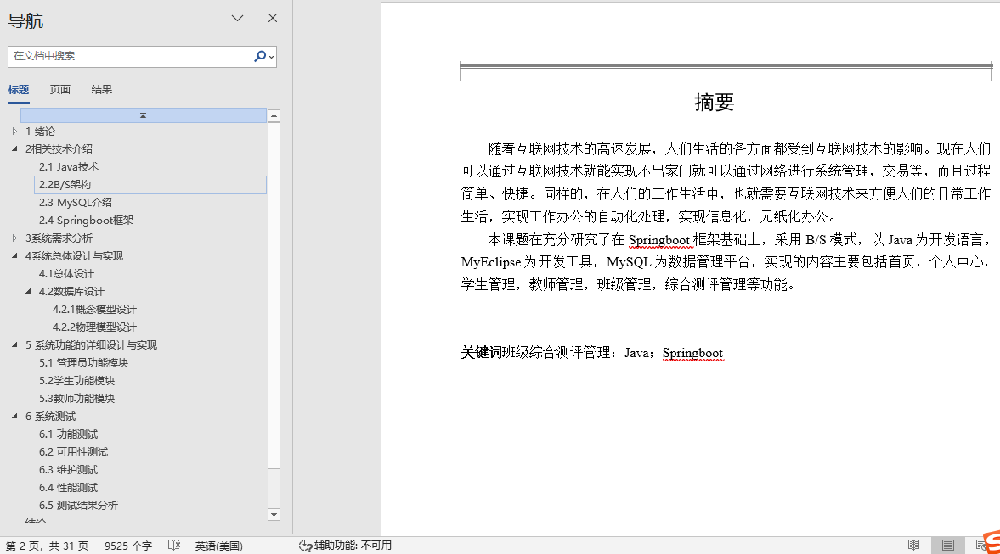

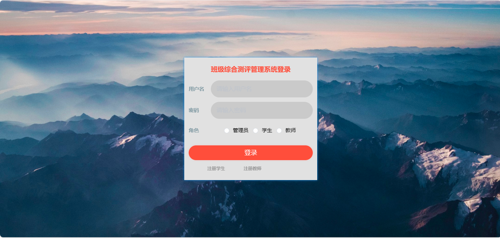

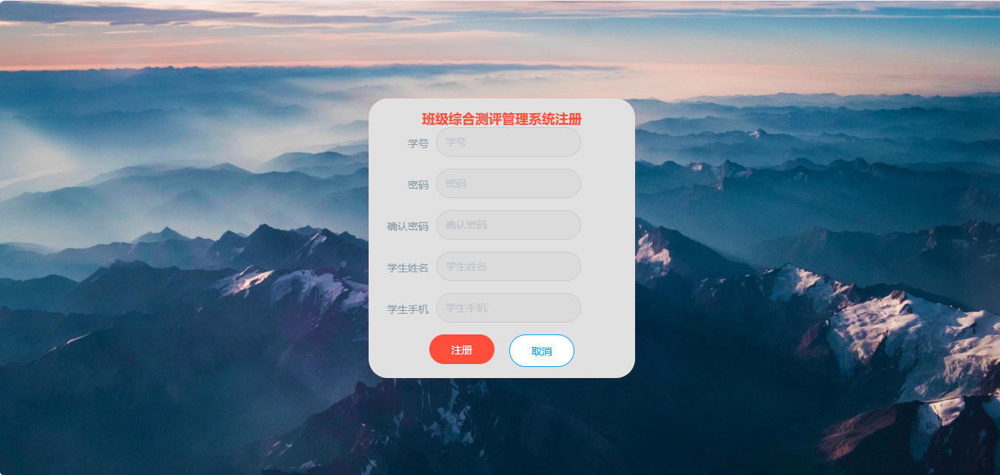

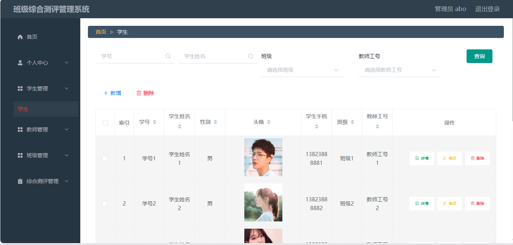

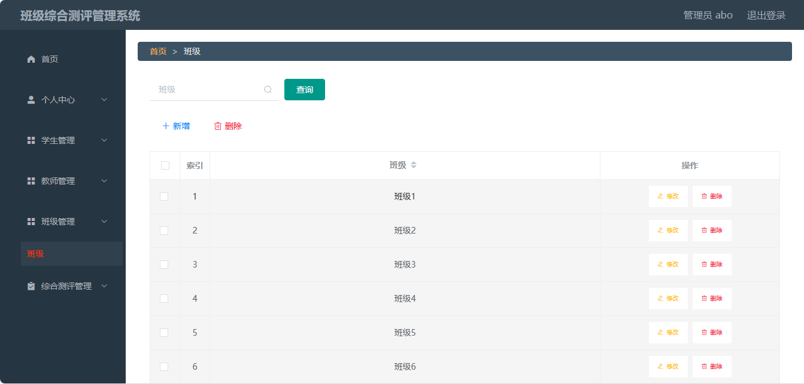

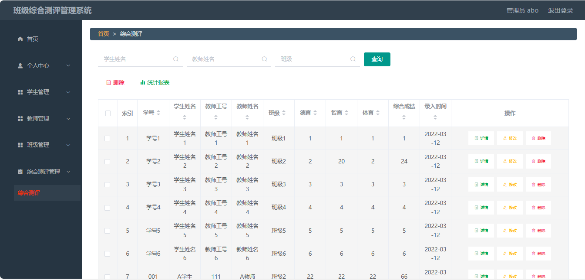

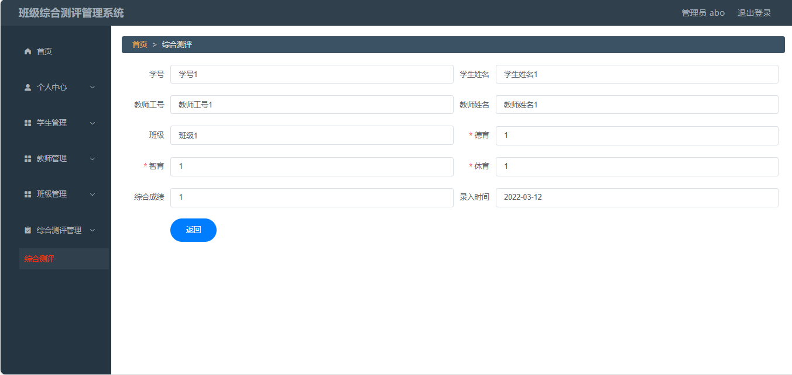

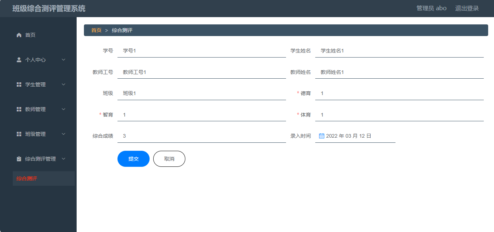

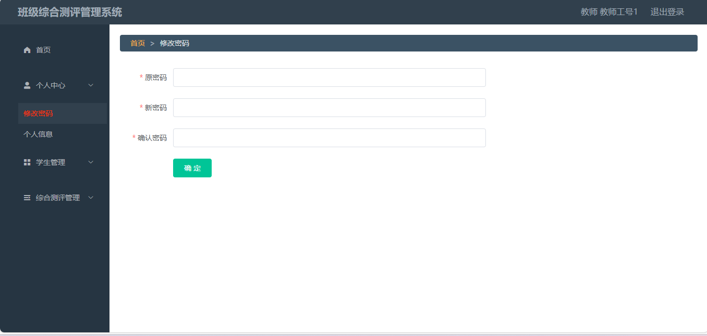

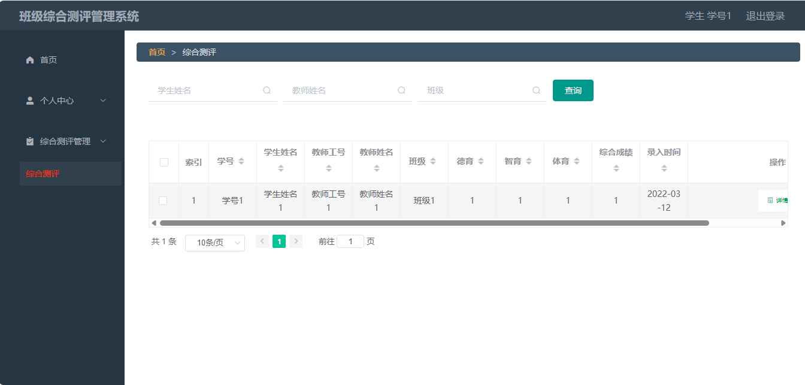

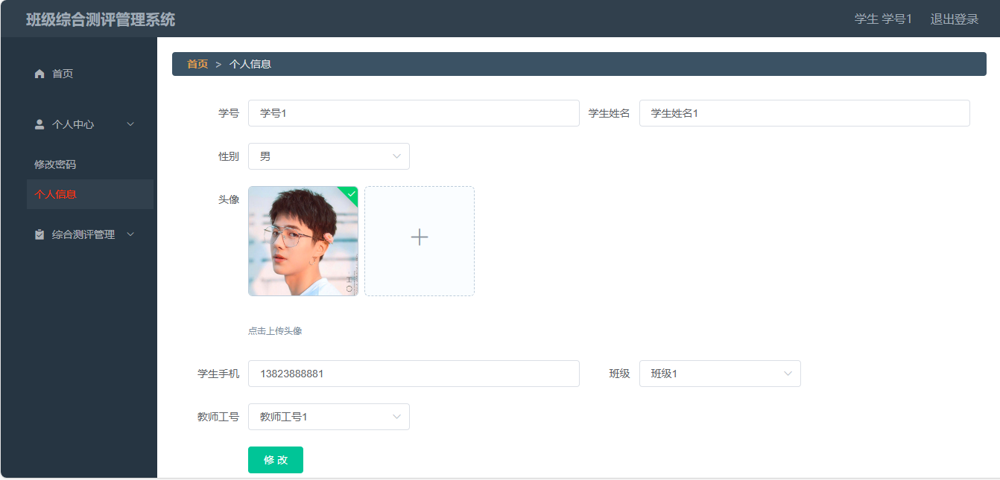